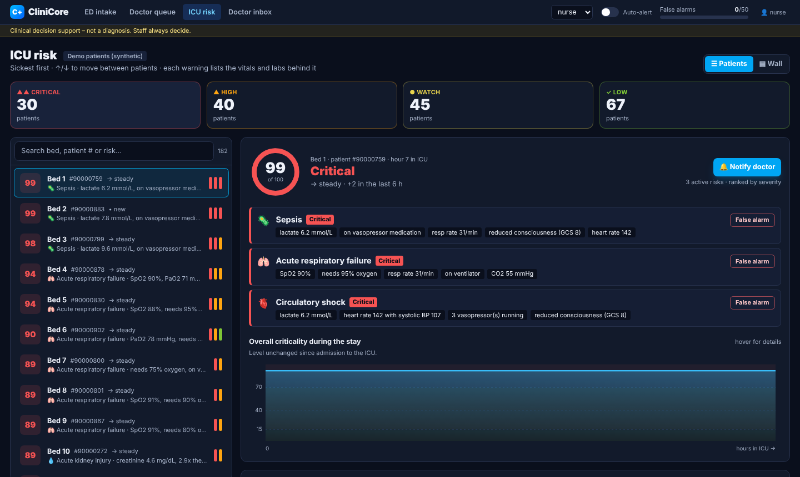
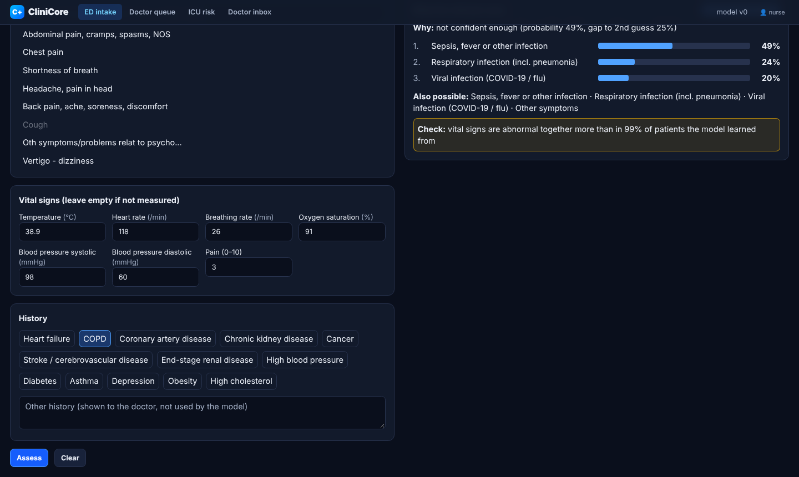
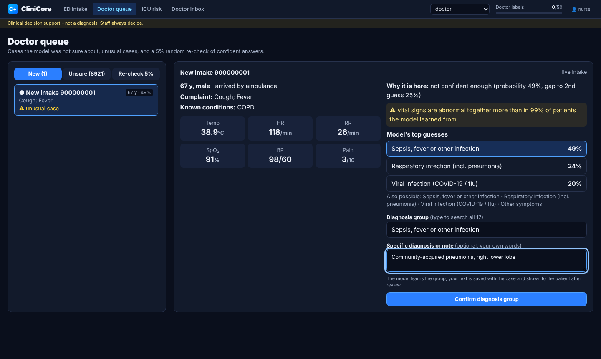
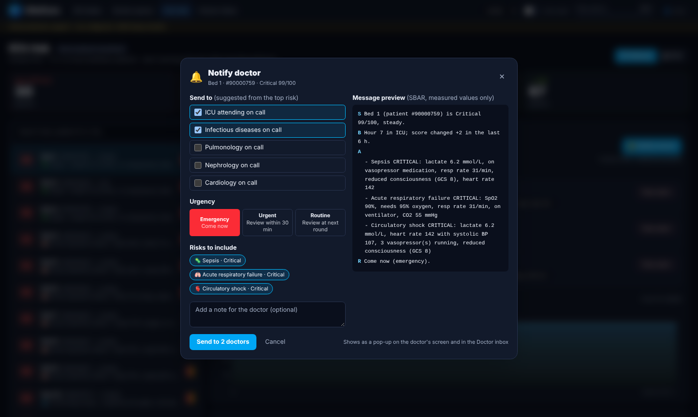
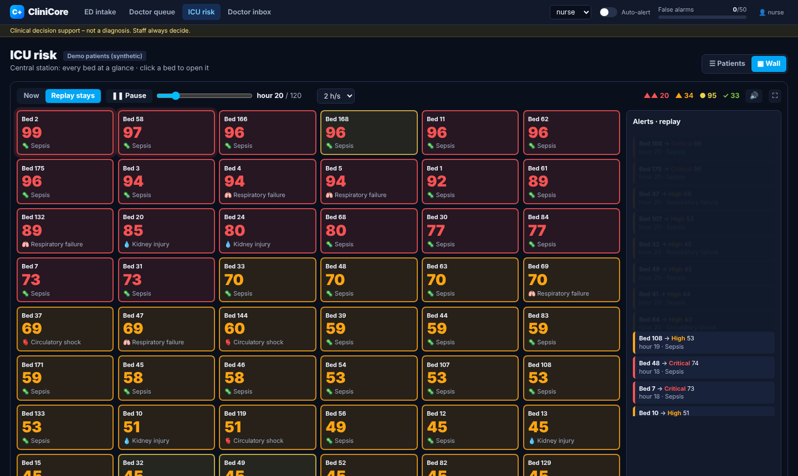

# CliniCore

**Clinical decision support from the ED front door to the ICU bed: predictions that show their evidence, flag their uncertainty and keep clinicians in charge.**

Built for the Exasol × Medical Valley EMN Healthcare Hackathon (Nov 2026, theme *Earn Trust*). Runs fully local on [Exasol](https://www.exasol.com) or on plain files.

> CliniCore is a research prototype. It is not a medical device and must not be used for patient care.



## What it does

| Stage | Who uses it | What happens |
|---|---|---|
| **1 · ED intake** | triage nurse, patient | Age, complaint, vital signs and history → a **diagnosis group** (17 groups). The patient sees an answer only when the model is confident **and** the case looks like the training data; otherwise *"A doctor will review your case"*. |
| **2 · Doctor in the loop** | ED doctor | Unsure and unusual cases plus a random 5 % of confident answers go to a doctor queue. The doctor confirms a group and can add their own words. **Every 50 labels the model retrains itself** and goes live only if it passes a safety check. |
| **3 · ICU risk** | ICU nurse, doctor | Each hour: sepsis, respiratory failure, kidney injury and circulatory shock, **ranked by severity**, each shown with the vitals and labs behind it, plus an overall criticality score and an early warning when a risk is about to reach *High*. Wall view with hour-by-hour replay for the central station. |
| **Escalation** | nurse → on-call doctor | *Notify doctor* sends an SBAR message to the right on-call doctor (ICU attending + specialist for the top risk); it pops up on the doctor's screen, who answers *On my way* / *Acknowledge*. Optional auto-alert for rising Critical patients. |
| **Learning from false alarms** | ICU staff | A false alarm needs a reason (sensor error, expected for this patient, already treated, …). **Every 50 false alarms the ICU models retrain**; "the warning was right but treatment prevented the event" is logged but never taught as a false alarm. |

| ED intake | Doctor queue | Notify doctor | Wall replay |
|---|---|---|---|
|  |  |  |  |

## Results on real data

All numbers are measured on data the model never saw while training. Details and caveats: [docs/results.md](docs/results.md).

**Stage 1, NHAMCS emergency departments (US, public data).** Trained on 2018–2021, tested on 2022 (11,607 adult visits, 17 groups):

| | |
|---|---|
| Accuracy (one guess) | **59.0 %** (always guessing the most common group: 17 %) |
| Right group in the top 3 | **82.8 %** |
| Answered automatically / correct when answered | 23.1 % / **83.5 %** (the rest goes to a doctor) |
| Wrong group shown to a patient | 3.8 % of all patients |
| Calibration error (ECE) | 0.022 |

Some groups are weak from triage data alone: *sepsis / fever / other infection* 18 %, *metabolic* 28 %, *viral / COVID-19 / flu* 32 %. These patients look alike at the front door (fever, fast heart rate, feeling unwell). They need blood tests to tell them apart, and the system responds the right way: it is unsure, so **these cases go to a doctor**.

**Stage 3, PhysioNet/CinC 2019 sepsis (40,336 real ICU patients, two hospital systems).** Trained on hospital A, tested on all 20,000 hospital-B patients:

| Model | AUPRC | AUROC | Utility (approx.) | Septic patients alerted | False-alert hours / 24 h |
|---|---|---|---|---|---|
| **LightGBM (chosen)** | 0.069 | 0.800 | 0.306 | 62 % | 1.24 |
| GRU-D | 0.045 | 0.737 | 0.110 | 73 % | 3.94 |
| GRU-D + LightGBM | 0.075 | 0.801 | 0.301 | 60 % | 1.27 |

Decision rule fixed in advance: keep the simplest model unless another one wins on **both** AUPRC and utility with 95 % confidence. The hybrid's AUPRC gain was real but tiny (+0.002 to +0.011) and its utility gain was not significant, so LightGBM stays. Chance-level AUPRC is about 0.018. We make **no** "state of the art" claim: the split is not the official hidden test set and the utility score is our re-implementation.

## Quick start (Windows, ~5 minutes)

Requirements: Python 3.11+ (tested on 3.14). Node.js is **not** needed; the web app is pre-built.

```powershell
git clone https://github.com/<you>/CliniCore.git
cd CliniCore
pip install -r requirements.txt
powershell -ExecutionPolicy Bypass -File scripts\start_app.ps1
```

The browser opens <http://127.0.0.1:8765>. The repository ships a ready-to-run demo state: the Stage 1 model trained on NHAMCS, the 2022 test visits, and an ICU board of synthetic patients.

**Real ICU patients on the board** (downloads PhysioNet 2019, ~45 MB, then trains on hospital A and shows hospital B):

```powershell
python pipeline\sepsis2019_load.py --no-exasol
python pipeline\physionet_icu.py --source csv
```

**Automatic retraining** (second window, leave it running):

```powershell
python pipeline\retrain.py watch --source csv --dir data\samples\synth_default --live3-dir data\samples\synth_hospital_c --stage1-nhamcs nhamcs_cache
```

Linux/macOS: `scripts/start_app.sh` and the same `python pipeline/...` commands.

## With Exasol

```powershell
$env:EXA_PASS = "<your SYS password>"            # or leave empty: read from the Exasol Personal starter kit
python pipeline\sepsis2019_load.py                # PhysioNet 2019 -> CAREGUARD_SEPSIS19.SEPSIS2019
python pipeline\physionet_icu.py --source exasol  # ICU models + board -> CAREGUARD_RESULTS
python pipeline\nhamcs_stage1.py --cache nhamcs_cache --model logreg --exasol
python scripts\selftest_exasol.py                 # 4 checks against your database
powershell -ExecutionPolicy Bypass -File scripts\start_app.ps1 exasol
```

Sharing the database, exporting it for others, read-only users: [docs/exasol.md](docs/exasol.md).

## Bring your own data: MIMIC-IV or a live hospital feed

The ICU code reads **MIMIC-IV-shaped tables** (`icustays`, `chartevents`, `labevents`, `inputevents`, `outputevents`, …). The synthetic data, a MIMIC-IV extract, or a live feed written into Exasol in that shape all go through the same code. [docs/bring-your-own-data.md](docs/bring-your-own-data.md) covers:

- training Stage 3 on MIMIC-IV: `python pipeline\stage3_multirisk.py --dir <mimic-iv> --shift-dir <other site> --data-label "MIMIC-IV patients"`
- training Stage 1 on MIMIC-IV-ED: `python pipeline\mimic_ed.py ...` then `nhamcs_stage1.py --split random`
- scoring live data every 15 minutes with saved models, without retraining: `python pipeline\stage3_score.py --source exasol --schema ICU_LIVE`

## Repository layout

```
pipeline/   data loaders, risk rules, models, retraining (Python)
app/        CliniCore web app: backend/ (FastAPI) + frontend/ (React, pre-built in frontend/dist)
data/       synthetic MIMIC-IV-shaped samples (5 hospital profiles) + table schema
docs/       architecture, data and licences, results, Exasol, bring-your-own-data
scripts/    start the app, build everything, Exasol self-test / export / import / read-only sharing
tests/      pipeline tests (pytest); app tests in app/backend/tests, browser test in app/tests
models/, results/, nhamcs_cache/   ready-to-run demo state (rebuilt by the pipeline)
```

How it fits together: [docs/architecture.md](docs/architecture.md).

## Tests

```powershell
python -m pytest -q tests                                  # 101 pipeline tests
cd app\backend; python -m pytest -q tests -k "not live"    # 14 app tests, including Exasol mode against a strict stand-in
```

## Data and licences

Code: MIT ([LICENSE](LICENSE)). Data have their own terms, see [docs/data.md](docs/data.md):
NHAMCS is US public domain; PhysioNet/CinC 2019 is CC BY 4.0 (cite it); **MIMIC-IV must never be committed or shared** (PhysioNet credentialed licence). The synthetic data is generated by `pipeline/synth_mimic.py`.

## Credits

Built by a team of four at the Exasol × Medical Valley EMN Healthcare Hackathon 2026. The ICU central-monitor wall and the dark visual design started from our teammate's *CarePriority* UI.
