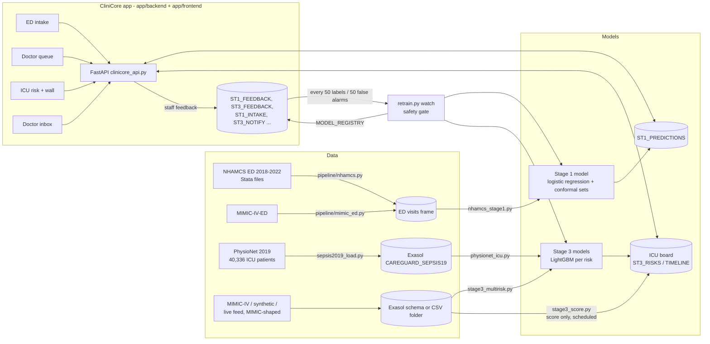

# Architecture

## Stage 1: ED intake
- **Inputs**: age, sex, arrival by ambulance, triage level, up to 3 reasons for visit (NHAMCS codes and their words, or free text), temperature, heart rate, breathing rate, SpO2, blood pressure, pain, 13 chronic conditions.
- **Model**: TF-IDF of the complaint plus standardised vitals with missing-value flags, feeding a multinomial logistic regression. LightGBM and an MLP were tried; neither beat it on validation.
- **Routing** (`stage1_pipeline.route`): *confident* = top probability ≥ 0.80 **and** a gap of ≥ 0.15 to the second guess **and** no unusual-case flag. Flags: a vital outside the 0.5–99.5 % range of training patients, an unseen main complaint, or 3+ of 5 key vitals missing. Everything else goes to the doctor queue. A random 5 % of confident answers also goes to a doctor (audit).
- **Plausible set**: split-conformal prediction set at 90 % coverage, shown to doctors as "also possible".
- **Patient view**: a diagnosis *group*, never a diagnosis; nothing at all when unsure.

## Stage 3: ICU risk
- **Hourly panel** (`scores.build_hourly_panel` for MIMIC-shaped tables, `physionet_icu.to_panel` for PhysioNet). Vitals are forward-filled up to 6 h and labs up to 48 h, with "hours since measured" kept as a feature.
- **Rule tiers** per risk (`risks.py`), from published definitions: sepsis (SIRS, qSOFA, SOFA, septic-shock proxy), acute respiratory failure (P/F, S/F, ROX, NEWS2 respiratory points), acute kidney injury (KDIGO creatinine and urine output), circulatory shock (SCAI-style stage, shock index, lactate, vasopressors). Tiers are Low, Watch, High and Critical. Score names stay in the backend; staff see the measurements.
- **Early-warning models**: one LightGBM per risk. Each predicts whether the risk reaches High within 6 h (12 h for kidney), or Sepsis-3 onset within 6 h. The alert threshold is set on validation patients at 0.15 alerts per patient-day.
- **Overall criticality** = 100 · (1 − ∏(1 − severity)). Severity is 0 / 0.15 / 0.45 / 0.80 by tier, plus 0.10 when the model expects escalation. Levels are <15 Low, 15–39 Watch, 40–69 High, ≥70 Critical. This is our own composite, **not** a validated clinical score.

## Human in the loop and retraining (`pipeline/retrain.py`)
- Counters are independent: 50 new doctor labels (Stage 1) or 50 new false alarms (Stage 3). Each counter restarts after every attempt.
- **Safety gate**: a retrained model goes live only if it is no worse on frozen data. Stage 1: accuracy ≥ old − 0.02 and ≥ first version − 0.03. Stage 3: per risk, AUPRC and caught events within 0.02 of the old model. Every attempt is logged in `MODEL_REGISTRY`, rejected ones too.
- The app reloads a promoted Stage 1 model by itself. After a promoted Stage 3 retrain the ICU board is rebuilt with the new models.
- False alarms marked "warning was right, treatment prevented the event" count toward 50 but are never taught as "no event". This avoids the treatment paradox, where a model that learns from prevented events goes quiet.

## Escalation (`/api/notify`)
SBAR message (Situation, Background, Assessment, Recommendation) built only from measured values. It is suggested for the ICU attending plus the specialist for the top risk. It pops up on any CliniCore screen signed in as that doctor (polled every 4 s), and the doctor's reply shows on the ICU board. The auto-alert switch sends one emergency alert per Critical patient whose score is rising or new, until a doctor responds.

## Storage
Same table names in CSV mode (`app_state/*.csv`, `results/`) and Exasol mode (`CAREGUARD_RESULTS`). Staff tables are append-only. Result tables are rebuilt on every pipeline run. One Exasol connection is shared by the app and every access is serialised.
