# CliniCore: technical report

**Exasol × Medical Valley EMN Healthcare Hackathon, Erlangen, 12–14 November 2026 · theme *Earn Trust***

CliniCore supports hospital staff from the emergency-department (ED) front door to the intensive-care (ICU) bed. It predicts, shows the evidence, says when it is unsure, sends unsure cases to a doctor, and learns from the doctors' and nurses' corrections.

> Research prototype. Not a medical device. Not for patient care.

---

## Contents

1. Summary
2. The problem and who uses CliniCore
3. System overview
4. Data
5. Stage 1: ED intake model
6. Stage 2: doctor-in-the-loop learning
7. Stage 3: ICU multi-risk model
8. All models at a glance (layers and sizes)
9. Comparison with published work
10. Escalation: notifying the right doctor
11. The staff app
12. Exasol integration
13. How we evaluated (metrics explained)
14. Limitations and safety
15. Reproducing everything
16. References

---

## 1. Summary

| | Stage 1 · ED | Stage 3 · ICU |
|---|---|---|
| Question | Which of 17 diagnosis groups? Is the model sure? | Will sepsis, breathing failure, kidney injury or shock reach *High* in the next hours? |
| Data | NHAMCS, 64,169 adult ED visits, 2018–2022 | PhysioNet/CinC 2019, 40,336 ICU patients, 2 hospital systems |
| Model | Multinomial logistic regression (0 hidden layers) | LightGBM, one per risk (300 trees each) + bedside rule tiers |
| Tested on | 11,607 visits from 2022 (later year, never trained on) | Hospital B (a different hospital system, never trained on) |
| Key result | 59.0 % accuracy (baseline 17 %), top-3 82.8 %; when it answers alone it is right 83.5 % | AUROC sepsis 0.75–0.80, breathing 0.84, kidney 0.91, shock 0.94; beats qSOFA and NEWS2 on the same patients |
| Human in the loop | Unsure (77 %) → doctor queue; 50 labels → retrain behind a safety gate | False alarm needs a reason; 50 reasons → retrain behind a safety gate |
| Cost and speed | 3.6 ms per case on a laptop CPU, ≈ $0 to run | 3.6 ms per bed (4 risks), ≈ $0 to run; an LLM would take seconds and $46–$4,600 a year per hospital (section 9) |

Neural networks were tried at both stages (an MLP 64 → 32 for Stage 1, GRU-D for Stage 3). Both were worse on our real data than the simpler models, so the final system uses the simpler, calibrated, readable models.

---

## 2. The problem and who uses CliniCore

EDs and ICUs are short of time and staff. Two bottlenecks:

- **ED:** every patient needs a first assessment. Some cases are clear from the triage data; many are not. Doctors' time should go to the unclear ones.
- **ICU:** patients deteriorate over hours. Warnings come late or too often (alert fatigue). A widely deployed commercial sepsis alert was found, in independent testing, to miss two-thirds of sepsis cases while alerting on almost one in five patients (section 9).

CliniCore's goal is to optimise that workflow for **hospital staff**:

| User | What CliniCore does for them |
|---|---|
| Triage nurse | Enters the triage form; gets a diagnosis group with a confidence check, or "doctor review". |
| ED doctor | Sees only the unsure and unusual cases plus a 5 % random re-check, with the model's top guesses; confirms a group and can add free text. |
| ICU nurse | One screen: all beds with live vitals, criticality score, ranked risks with the evidence; marks false alarms with a reason. |
| On-call doctor | Gets a structured pop-up (SBAR) for a deteriorating patient and replies *On my way* / *Acknowledged*. |
| Developers | Metrics, model registry, retraining history (not shown to clinical staff). |

---

## 3. System overview

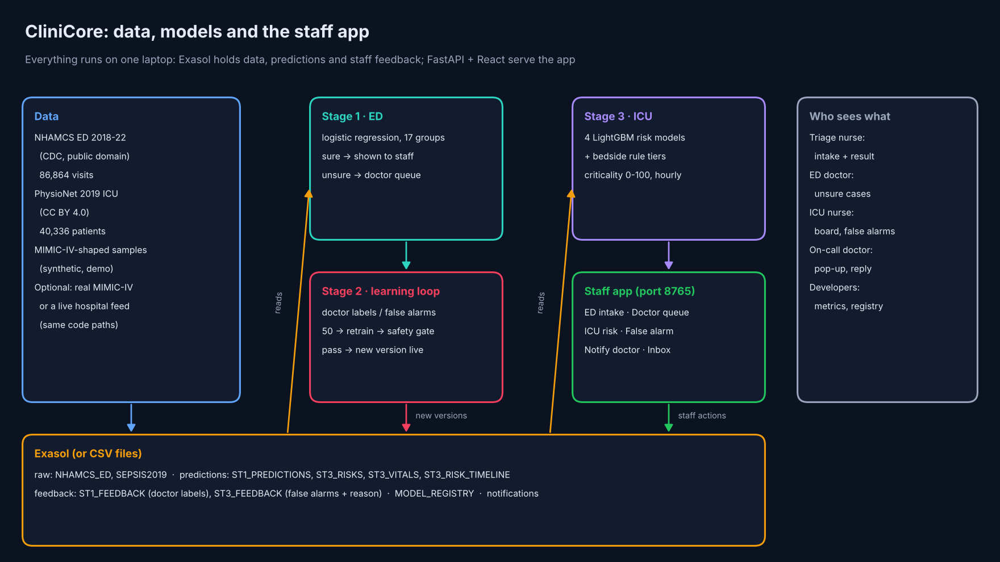

Everything runs on one laptop. Exasol (or plain CSV files) holds the raw data, the model outputs and all staff feedback. Python pipelines train and score the models; a FastAPI back end and a React front end serve the staff app on port 8765.

---

## 4. Data

| Dataset | What | Size used | Licence | Split |
|---|---|---|---|---|
| **NHAMCS ED 2018–2022** (CDC) | US national ED visit survey: triage vitals, reason-for-visit codes, chronic conditions, ICD-10 diagnoses | 86,864 visits → 68,504 adults → **64,169** with a usable first diagnosis | Public domain | Train 2018–2021 (42,049), validation 20 % of those years (10,513), **test 2022 (11,607)** |
| **PhysioNet/CinC 2019** | Hourly ICU vitals, labs, demographics, Sepsis-3 labels | **40,336** patients, 1,552,210 hours; hospital A 20,336, hospital B 20,000 | CC BY 4.0 (cite Reyna et al.) | Train hospital A, **test hospital B** |
| MIMIC-IV-shaped samples | Synthetic patients in MIMIC-IV table layout (5 clinical profiles) | demo only | ours | – |
| MIMIC-IV / MIMIC-IV-ED (optional) | Real hospital EHR | not included | PhysioNet credentialed; **never shared or committed** | `--split random` |

**Why these splits matter.** Testing on a *later year* (Stage 1) and a *different hospital system* (Stage 3) checks that the models still work when the world changes, which is exactly where published models often fail (section 9).

**Diagnosis groups (Stage 1).** The first ICD-10 diagnosis of each visit is mapped to 17 groups: abdominal/GI, chest pain/cardiac, heart rhythm/failure/BP/vascular, respiratory infection, asthma/COPD/other respiratory, viral/COVID/flu, sepsis/fever/other infection, urinary/kidney, neuro/stroke/headache/syncope, mental/substance, injury/poisoning, musculoskeletal pain, skin/soft tissue, gynecologic/obstetric, metabolic/endocrine/blood, eye/ear/cancer/other, other symptoms/signs. Z-codes and blanks are dropped.

---

## 5. Stage 1: ED intake model

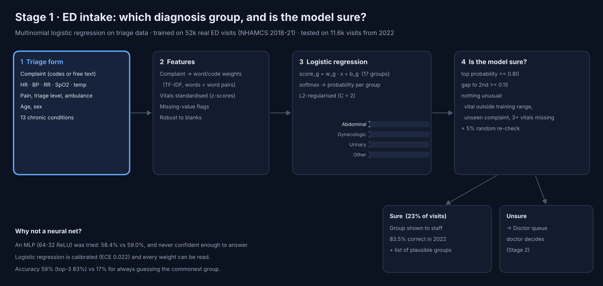

### 5.1 Inputs and features

| Input | How it enters the model |
|---|---|
| 12 numbers: temperature, heart rate, respiratory rate, SpO2, systolic BP, diastolic BP, triage level, early-warning points from triage vitals, age, sex, arrival by ambulance, number of chronic conditions | Median-filled, then z-scored (mean 0, SD 1) |
| A missing flag for each of the 12 numbers | 0/1, so a blank is not mistaken for "normal" |
| Complaint: up to 3 reason-for-visit codes plus their words, or free text | TF-IDF of 1- and 2-word terms seen at least twice: **18,011** text features |

Total: **18,035 inputs** per visit (sparse).

### 5.2 Model: multinomial logistic regression

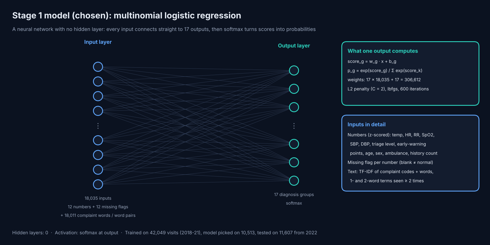

Logistic regression is the simplest neural network: **one layer, no hidden layers**. Every input connects directly to each of the 17 outputs:

- score for group *g*: `s_g = w_g · x + b_g`
- probability: `p_g = exp(s_g) / Σ_k exp(s_k)` (softmax)
- size: 17 × 18,035 weights + 17 biases = **306,612 parameters**
- training: cross-entropy loss with L2 penalty (C = 2), lbfgs solver, up to 600 iterations (scikit-learn)

Because it is trained directly on log-loss, its probabilities are already well calibrated (ECE 0.022), which matters because the routing rule depends on them.

### 5.3 "Is the model sure?" routing

A prediction is shown to staff as a confident answer only if **all** hold:

1. top probability ≥ **0.80**
2. gap to the second group ≥ **0.15**
3. nothing unusual about the patient:
   - a vital sign outside the 0.5–99.5 % range seen in training
   - a main complaint the model has never seen
   - 3 or more of the 5 key vitals missing
   - a combination of abnormal vitals beyond the training range

Otherwise the case goes to the **doctor queue**. In addition, **5 % of confident answers** are sent for a random re-check (chosen by a hash of the visit id, so it is reproducible). When the model is unsure, no single guess is shown to the patient; the doctor sees the top guesses.

**Plausible-group set.** Split-conformal prediction (α = 0.10, threshold q̂ = 0.967 on validation) gives each visit a short list of groups that contains the true group 90 % of the time. On 2022 it covered the truth **89.1 %** of the time with **3.9** groups on average.

### 5.4 Results (2022 test, 11,607 visits)

| Metric | Value |
|---|---|
| Accuracy, one guess | **59.0 %** (always guessing the most common group: 17 %) |
| Right group in top 3 | **82.8 %** |
| Calibration error (ECE) | 0.022 |
| Answered automatically | 23.1 % of visits |
| Correct when answered automatically | **83.5 %** |
| Wrong group shown as confident | 3.8 % of all visits |
| Accuracy on cases sent to a doctor | 51.7 % (these are the hard ones) |

**Choosing the threshold** (2022 test):

| Confidence threshold | Answered automatically | Correct when answered |
|---|---|---|
| 0.5 | 64.6 % | 71.0 % |
| 0.6 | 52.8 % | 74.6 % |
| 0.7 | 38.6 % | 78.6 % |
| **0.8 (used)** | **23.1 %** | **83.5 %** |
| 0.9 | 9.0 % | 89.1 % |

**Per group** (accuracy in 2022): abdominal 80 %, chest pain 75 %, gynecologic 75 %, mental health 73 %, injury 73 %, neuro 63 %, musculoskeletal 63 % … metabolic 28 %, other symptoms 28 %, heart rhythm/failure 31 %, viral/COVID 32 %, **sepsis/fever/infection 18 %**.

The weak groups look alike at triage (fever, fast pulse, feeling unwell) and need blood tests to tell apart. The model is unsure about exactly these patients, so **they go to a doctor**: the routing is doing its job.

### 5.5 Alternative tried: multilayer perceptron (MLP)

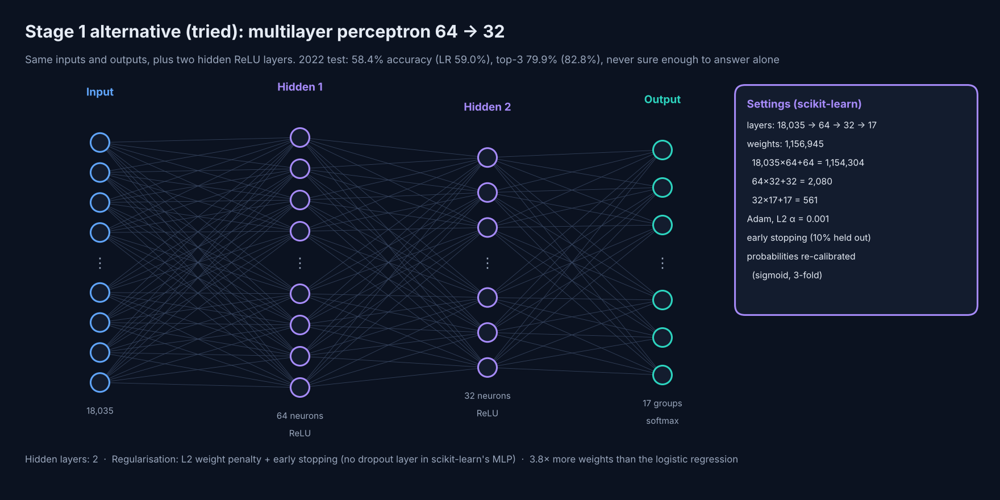

| | Logistic regression (chosen) | MLP 64 → 32 |
|---|---|---|
| Hidden layers | 0 | 2 (64 and 32 neurons, ReLU) |
| Parameters | 306,612 | 1,156,945 |
| Regularisation | L2 (C = 2) | L2 (α = 0.001) + early stopping; sigmoid re-calibration (3-fold) |
| Accuracy 2022 | **59.0 %** | 58.4 % |
| Top-3 2022 | **82.8 %** | 79.9 % |
| ECE | **0.022** | 0.035 |
| Answered automatically at 0.80 | **23.1 %** | **0 %** (never confident enough) |

The MLP is larger, slightly less accurate, worse calibrated, and after calibration it is never sure enough to answer alone, so every patient would go to a doctor. LightGBM was also tried and was no better than logistic regression on validation. **Decision: logistic regression.**

---

## 6. Stage 2: doctor-in-the-loop learning

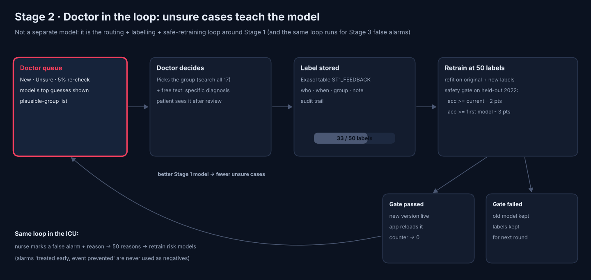

Stage 2 is not a separate model. It is the loop that turns staff corrections into better models, safely.

**ED (Stage 1):**

1. The doctor queue has three tabs: *New*, *Unsure*, *Re-check 5 %*.
2. The doctor picks the correct group (searchable list of all 17) and can add free text (the specific diagnosis), which the patient view shows after review.
3. Each label is stored in Exasol (`ST1_FEEDBACK`: visit, group, note, who, when).
4. At **50 new labels** the model is refitted on the original training data plus all doctor labels.
5. **Safety gate** on the held-out 2022 set: new accuracy ≥ current − 2 points **and** ≥ first model − 3 points.
6. Pass → new version registered in `MODEL_REGISTRY`, and the app reloads it automatically. Fail → old model stays; labels are kept for the next round.

**ICU (Stage 3), same pattern:**

1. A nurse can only press **False alarm** (there is no "real warning" button) and must choose a reason:
   - sensor or measurement error
   - expected for this patient
   - already being treated
   - treated early, event prevented
   - wrong risk type
   - other (note required)
2. Stored in `ST3_FEEDBACK`. At **50 false alarms** the four risk models retrain with these hours as negatives.
3. **"Treated early, event prevented" is logged but never used as a negative**: the warning was right; teaching the model otherwise would make it worse.
4. Gate per risk: AUPRC and recall on the validation set must not drop by more than 0.02; risks that fail keep their old model.
5. The board is republished with the new model version.

Verified end to end on PhysioNet-format data: 52 false alarms → retrain → sepsis and breathing models passed the gate, the kidney model was rejected → board republished as v1.

---

## 7. Stage 3: ICU multi-risk model

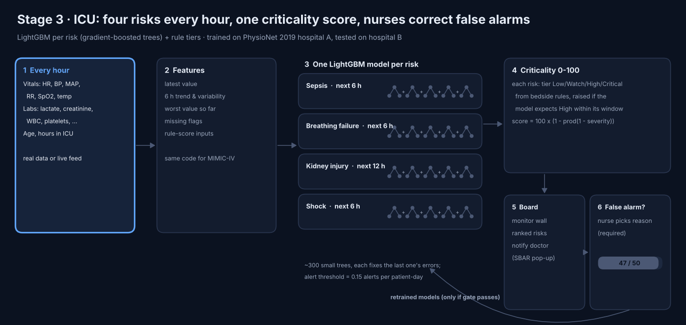

### 7.1 Hourly panel and features

Every ICU stay becomes one row per hour. The same code builds this panel from MIMIC-IV tables, from PhysioNet 2019 files, or from a live feed in MIMIC-IV layout.

**91 features per hour**, for example:

- latest values: heart rate, respiratory rate, SpO2, systolic BP, MAP, temperature, GCS, lactate, creatinine, platelets, WBC, bilirubin, pH, BUN, glucose
- bedside scores computed from them: NEWS2, SOFA, qSOFA, SIRS, shock index, P/F and S/F ratios, ROX index, KDIGO stage, creatinine ratio, SCAI-style shock stage
- **hours since each value was last measured** (stale data is information)
- 6-hour change, minimum and maximum of the key signals
- current rule tier for each risk
- age, sex, admission type, hours since admission, ICU type, prior admissions, 9 chronic conditions (hypertension, diabetes, heart failure, coronary disease, AF, COPD, CKD, liver disease, cancer)

### 7.2 Rule tiers (current state) and labels (future)

For each risk, published bedside criteria give a **current tier**: Low / Watch / High / Critical.

| Risk | Criteria behind the tier (developer view only) | Model predicts | Window |
|---|---|---|---|
| Sepsis | SIRS, qSOFA, SOFA | Sepsis-3 onset (PhysioNet label) | 6 h |
| Breathing failure | P/F, S/F, ROX index, NEWS2 respiratory points | tier reaches High | 6 h |
| Kidney injury | KDIGO (creatinine, urine output) | tier reaches High | 12 h |
| Shock | SCAI-style stage, shock index, MAP, lactate | tier reaches High | 6 h |

Staff never see the names of these standards; they see the evidence in plain words ("blood pressure falling over 6 hours, lactate 3.4").

### 7.3 Model: LightGBM, one per risk

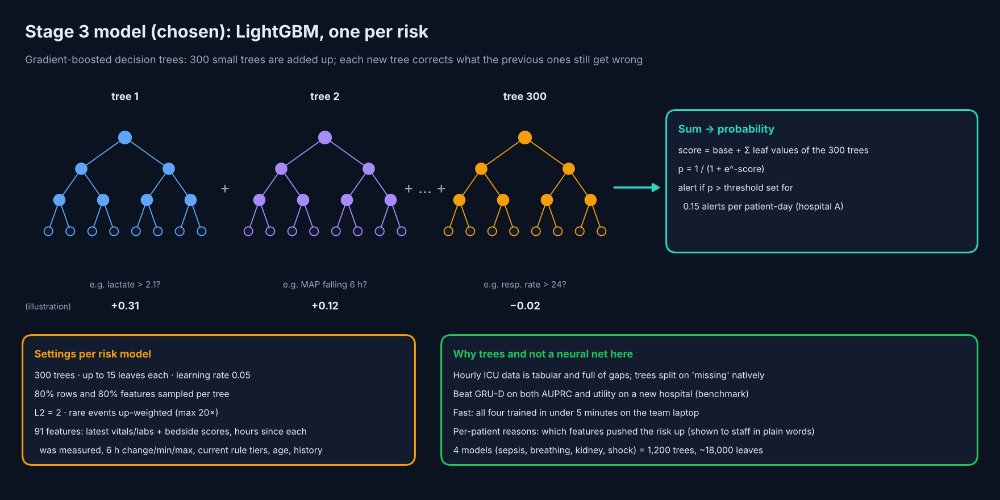

LightGBM is **gradient-boosted decision trees**, not a neural network:

- tree 1 makes a rough guess; tree 2 is fitted to what tree 1 got wrong; and so on for **300 trees**
- each tree has at most **15 leaves**; a patient-hour falls into one leaf per tree, and the leaf values are summed
- probability = `1 / (1 + e^(−sum))`
- learning rate 0.05; each tree sees 80 % of rows and 80 % of features; L2 = 2; rare events up-weighted (at most 20×)
- 4 risks × 300 trees = **1,200 trees, at most 18,000 leaves** in total

**Alert threshold:** set on hospital-A validation data so that each risk raises **0.15 alerts per patient-day** (an alert budget fixed in advance, to limit alarm fatigue).

### 7.4 Criticality score (0–100)

Each risk's tier gets a severity: Low 0, Watch 0.15, High 0.45, Critical 0.80, plus 0.10 if the model expects that risk to reach High within its window.

`criticality = 100 × (1 − Π_risks (1 − severity))`

Several moderate risks compound; one Critical risk alone gives ≥ 80. Levels: **Low < 15 ≤ Watch < 40 ≤ High < 70 ≤ Critical**.

### 7.5 Results on real patients

**Sepsis model comparison** (dedicated benchmark; train hospital A, test all 20,000 hospital-B patients):

| Model | AUPRC | AUROC | Utility (approx.) | Septic patients alerted | False-alert hours / 24 h |
|---|---|---|---|---|---|
| **LightGBM (chosen)** | 0.069 | **0.800** | **0.306** | 62 % | **1.24** |
| GRU-D | 0.045 | 0.737 | 0.110 | 73 % | 3.94 |
| GRU-D + LightGBM | 0.075 | 0.801 | 0.301 | 60 % | 1.27 |

Decision rule fixed in advance: keep the simplest model unless another wins on **both** AUPRC and utility with 95 % bootstrap confidence. The hybrid's AUPRC gain was tiny and its utility gain not significant. Chance-level AUPRC is about 0.018.

**All four risks** (multi-risk pipeline; train 12,000 hospital-A patients, test 6,000 hospital-B patients):

| Risk (window) | Events in B | AUROC A (validation) | AUROC B (new hospital) | AUPRC B | Bedside baseline on the same patients |
|---|---|---|---|---|---|
| Sepsis (6 h) | 1,963 | 0.807 | **0.753** | 0.033 | rule tier 0.615, qSOFA 0.583 |
| Breathing failure (6 h) | 16,679 | 0.848 | **0.840** | 0.334 | NEWS2 0.788, rule tier 0.613 |
| Kidney injury (12 h) | 2,800 | 0.924 | **0.909** | 0.221 | rule tier 0.589 |
| Shock (6 h) | 4,292 | 0.938 | **0.939** | 0.335 | rule tier 0.501 |

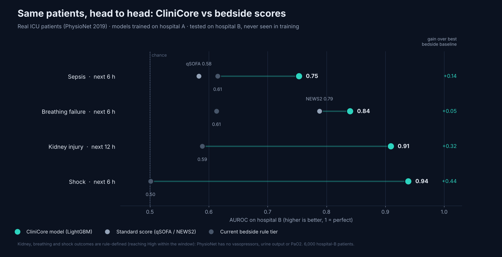

Scores barely drop from hospital A to hospital B, so the models generalise. The multi-risk sepsis model (0.753) is below the dedicated benchmark (0.800) because it shares one feature set with the other risks and uses 12,000 instead of 20,000 training patients. Breathing, kidney and shock outcomes are rule-defined because PhysioNet lacks vasopressor, urine-output and PaO2 data.

**ICU board:** 200 real hospital-B patients (50 later developed sepsis). Criticality levels: Low 93, Watch 64, High 31, Critical 12.

### 7.6 Alternative tried: GRU-D recurrent neural network

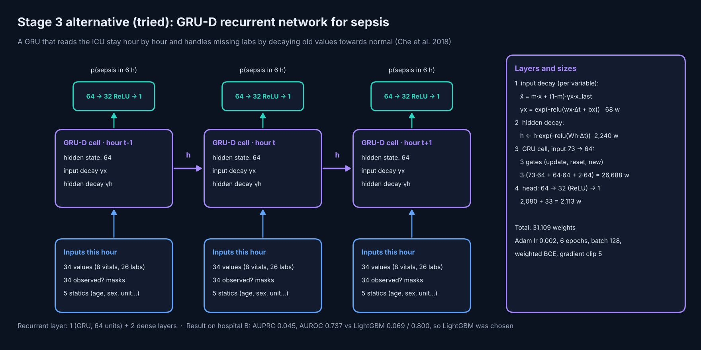

GRU-D (Che et al. 2018) is a recurrent network designed for irregular clinical time series with missing values:

| Layer | What it does | Size |
|---|---|---|
| Input decay | A missing value is replaced by the last observed value decayed towards the mean, faster the longer ago it was measured: `x̂ = m·x + (1−m)·γx·x_last`, `γx = exp(−relu(wx·Δt + bx))` | 68 weights (one w and b per variable) |
| Hidden decay | The memory fades during gaps: `h ← h · exp(−relu(Wh·Δt))` | 34 × 64 + 64 = 2,240 |
| GRU cell | Input each hour: 34 values + 34 observed-masks + 5 statics = 73; hidden state 64; update, reset and candidate gates | 3 × (73·64 + 64·64 + 2·64) = 26,688 |
| Output head | Dense 64 → 32 (ReLU) → 1 → sigmoid, every hour | 2,080 + 33 = 2,113 |
| **Total** | 1 recurrent layer + 2 dense layers | **31,109 parameters** |

Training: Adam (learning rate 0.002), 6 epochs, batch 128, class-weighted binary cross-entropy over all hours, gradient clipping at 5 (PyTorch). On the new hospital it was clearly worse than LightGBM (AUROC 0.737 vs 0.800, utility 0.110 vs 0.306) and produced three times as many false-alert hours.

---

## 8. All models at a glance (layers and sizes)

| Model | Stage | Status | Type | Layers / structure | Trainable size | Inputs → outputs |
|---|---|---|---|---|---|---|
| Logistic regression | 1 | **chosen** | linear softmax (one-layer neural net) | 0 hidden layers, 1 output layer (17) | 306,612 weights | 18,035 → 17 |
| MLP | 1 | tried | feed-forward neural net | 2 hidden (64, 32, ReLU) + softmax (17) | 1,156,945 weights | 18,035 → 17 |
| LightGBM (Stage 1) | 1 | tried | gradient-boosted trees | multiclass trees | – | same → 17 |
| LightGBM × 4 risks | 3 | **chosen** | gradient-boosted trees | 300 trees × ≤ 15 leaves per risk | ≤ 4,500 leaves per risk | 91 → 1 per risk |
| LightGBM sepsis benchmark | 3 | benchmark | gradient-boosted trees | ≤ 600 trees × ≤ 31 leaves, early stopping | – | 109 → 1 |
| GRU-D | 3 | tried | recurrent neural net | input decay + GRU (64) + dense 32 ReLU + output | 31,109 weights | 73 per hour → 1 per hour |
| GRU-D + LightGBM | 3 | tried | stack | GRU-D's out-of-fold score added as a LightGBM feature | – | 110 → 1 |

---

## 9. Comparison with published work

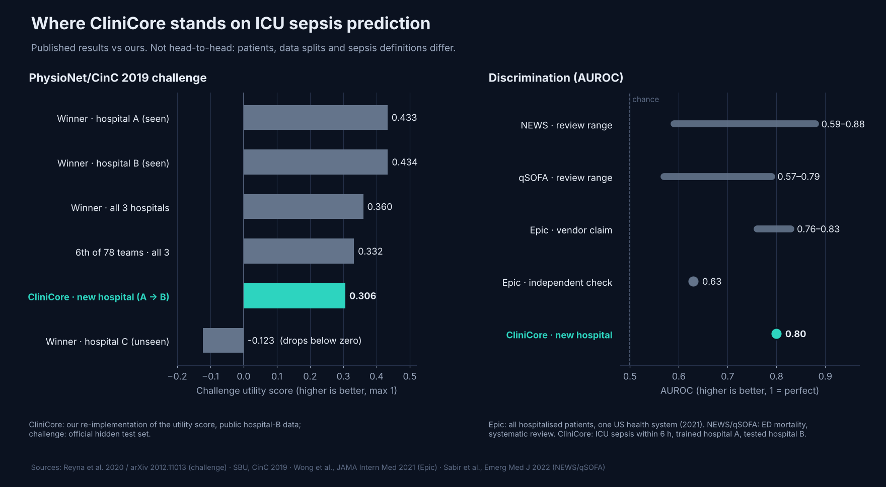

None of these are head-to-head (different patients, splits and sepsis definitions); section 7.5 has the head-to-head on the same patients.

- **PhysioNet 2019 winner:** utility 0.360 on the full hidden test set; 0.433 and 0.434 on hospitals A and B, which it trained on; **−0.123** on unseen hospital C. 6th of 78 teams: 0.332. CliniCore: about **0.306 on a hospital it never trained on**, in the same range as the leading teams, not above them.
- **Epic Sepsis Model** (Wong et al., JAMA Internal Medicine 2021, independent validation on 38,455 hospitalisations): AUROC **0.63** vs 0.76–0.83 reported by the vendor; missed 67 % of sepsis patients while alerting on 18 % of all patients; 12 % of its alerts were correct. CliniCore: AUROC 0.80 on a new hospital's ICU patients, 62 % of septic patients alerted at 1.24 false-alert hours per 24 h. Different population (all hospital patients vs ICU), so context, not a ranking.
- **Bedside scores** (Sabir et al., Emergency Medicine Journal 2022, systematic review, ED mortality): AUROC NEWS 0.59–0.88, qSOFA 0.57–0.79.
- **Stage 1:** no public benchmark exists for diagnosis groups from triage data; we compare against the majority baseline (17 %).

**What we claim:** an open, explainable pipeline, tested on a later year and on a new hospital, in the same range as published challenge entries, better than bedside scores on the same patients, with a fixed alert budget and a built-in loop for learning from staff. **What we do not claim:** beating the challenge winners, or clinical validation.

### Cost, compute and speed vs large language models

Could a large language model (LLM) do these jobs instead? We compared running costs for one hospital for one year: 150 ED visits a day (54,750 cases) and 20 ICU beds checked every hour (175,200 checks).

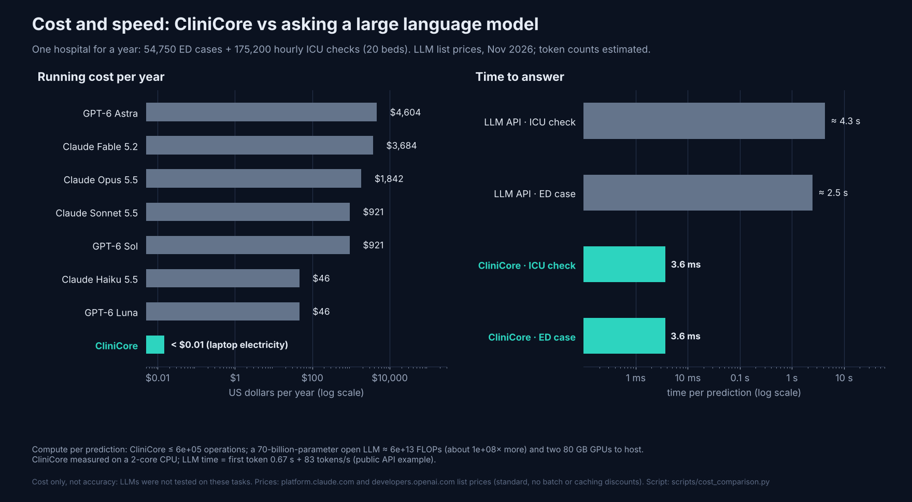

| | CliniCore | Small LLM (Claude Haiku 5.5 / GPT-6 Luna) | Mid LLM (Claude Sonnet 5.5 / GPT-6 Sol) | Large LLM (Claude Opus 5.5 · Fable 5.2 · GPT-6 Astra) |
|---|---|---|---|---|
| Price per 1M tokens (in / out) | – | $0.10 / $0.50 | $2 / $10 | $4 / $20 · $8 / $40 · $10 / $50 |
| Cost per ED case | ≈ $0 | $0.0001 | $0.0021 | $0.0042 – $0.0105 |
| Cost per ICU check | ≈ $0 | $0.0002 | $0.0046 | $0.0092 – $0.0230 |
| **Cost per year, one hospital** | **< $0.01** (laptop electricity) | $46 | $921 | $1,842 – $4,604 |
| Time per prediction | **3.6 ms** (measured, 2-core CPU) | ≈ 2.5 s (ED) to 4.3 s (ICU) | same | same |
| Compute per prediction | ≤ 0.6 million operations | ≈ 60 trillion FLOPs for a 70-billion-parameter open model (about 100 million times more) | | |
| Where patient data goes | stays on the hospital machine | sent to an external API (or GPUs to host one yourself: about two 80 GB GPUs for a 70B model) | | |
| Probabilities usable for routing | yes, calibrated (ECE 0.022) | not by default (text answers; would need calibration) | | |
| Same input → same output | yes | not guaranteed | | |
| Learns from 50 doctor labels | yes, retrains in minutes behind a gate | not directly (needs prompt changes or fine-tuning) | | |

Assumptions: about 300 input + 150 output tokens per ED case and 800 + 300 per ICU check (24 hours of hourly values), standard list prices without batch or caching discounts, LLM speed 0.67 s to first token plus 83 tokens/s (a public API example). Everything is in `scripts/cost_comparison.py`; change the assumptions there and rerun.

**What this shows honestly:**

- Money is not the main argument for one hospital: even the largest LLMs cost a few thousand dollars a year at this volume, and the smallest about $46. The gap grows with longer patient histories, more beds, more hospitals and reasoning models that bill extra output.
- The strong arguments are **speed** (milliseconds vs seconds, about 1,000× faster, so the whole ICU board refreshes instantly), **compute** (about 100 million times less, runs on any laptop with no GPU and no internet), **data protection** (patient data never leaves the hospital, which matters under GDPR), **calibrated probabilities** (the "is the model sure?" routing depends on them), **reproducibility** and **learning from staff** in minutes.
- We did **not** test LLM accuracy on these tasks, so this is a cost and operations comparison, not a quality ranking. An LLM could add value on top of CliniCore, for example drafting the free-text part of the doctor message, where its cost per call would be small.

---

## 10. Escalation: notifying the right doctor

- **Notify doctor** on any ICU patient: CliniCore drafts an **SBAR** message (Situation, Background, Assessment, Recommendation) from the measured values.
- Suggested recipients: ICU attending plus the specialist for the top risk (infectious disease for sepsis, pulmonology for breathing, nephrology for kidney, cardiology for shock); the nurse can change them.
- Urgency: emergency / urgent / routine.
- The message pops up on the doctor's screen (checked every 4 seconds) with *On my way*, *Acknowledged* or *Declined*; replies appear next to the patient per doctor.
- **Auto-alert** (switch): a patient who becomes or keeps rising at Critical notifies the attending automatically until someone replies.

---

## 11. The staff app

| ED intake | Doctor queue |
|---|---|
| 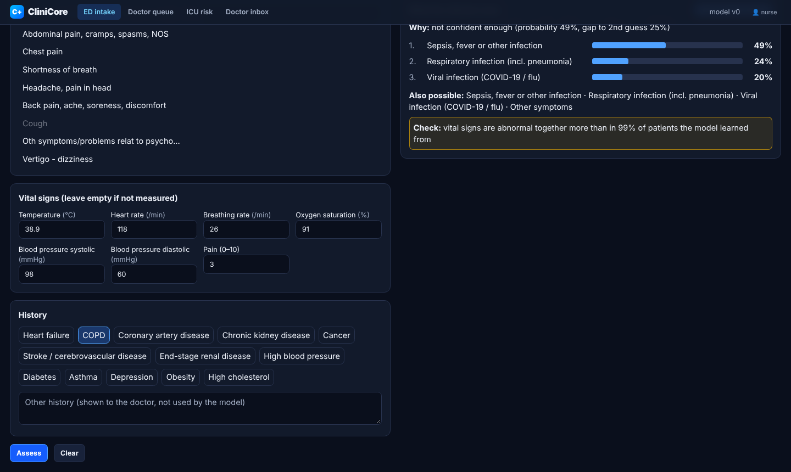 | 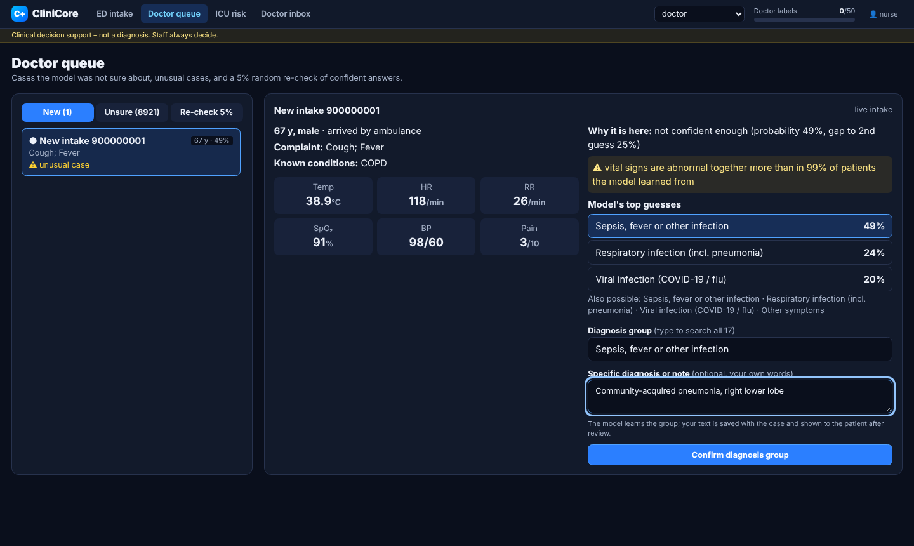 |

| ICU risk (one screen) | Notify doctor |
|---|---|
| 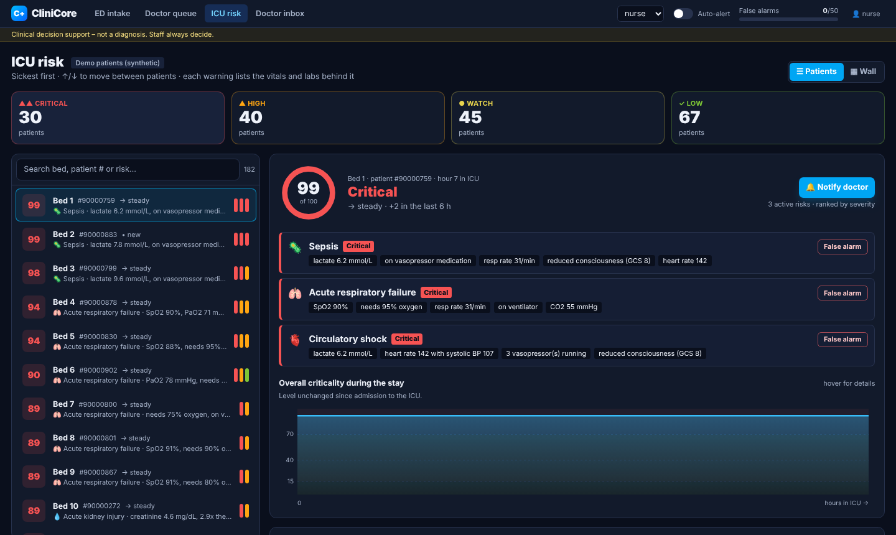 | 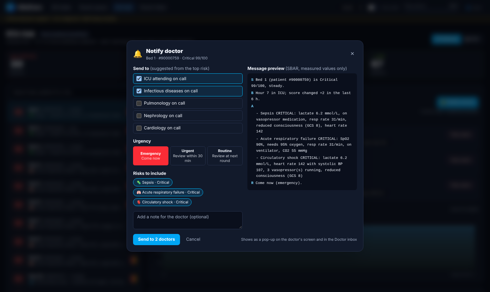 |

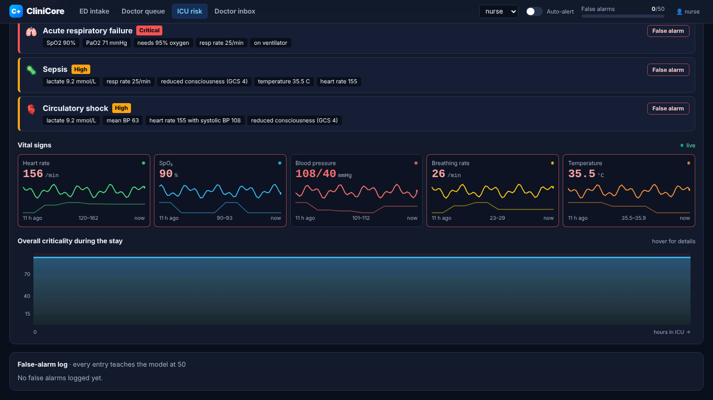

- **ED intake:** form with examples; result as a staff view (top groups, probabilities, plausible set, flags in plain words).
- **Doctor queue:** New / Unsure / Re-check; searchable groups; free-text diagnosis.
- **ICU risk:** monitor wall of all beds (score, HR, SpO2, BP, pulsing when critical) with level filters and search; selecting a bed shows the criticality ring, notify status, ranked risks with evidence and a **False alarm** button (reason required), the 48-hour risk timeline and live vitals. The live waveform is simulated around the real hourly values for the demo; a hospital deployment would use the monitor feed.
- **Doctor inbox:** messages, urgency, replies.

Stack: FastAPI (Python) + React/Vite/Tailwind, built into static files and served by the back end. Optional shared password (`CLINICORE_PASSWORD`) for hosting.

---

## 12. Exasol integration

- Raw data is loaded into Exasol: `CAREGUARD_NHAMCS.NHAMCS_ED`, `CAREGUARD_SEPSIS19.SEPSIS2019` (1,552,210 rows).
- Pipelines read from Exasol (`--source exasol`) and write predictions and boards back: `ST1_PREDICTIONS`, `ST3_RISKS`, `ST3_RISK_TIMELINE`, `ST3_VITALS`, `ST3_SOURCE`, benchmark results (`SEPSIS19_BENCH`).
- The app writes staff actions straight to Exasol: `ST1_FEEDBACK`, `ST1_LABEL_NOTES`, `ST3_FEEDBACK`, notifications and acknowledgements, `MODEL_REGISTRY`.
- Engineering details: reserved column names renamed on write and restored on read; wide text columns for append tables; one connection shared safely behind a lock; small reads over the open session instead of per-call exports; short caches for read-mostly tables.
- Sharing: export to files for a GitHub release (`scripts/export_exasol.py`, refuses MIMIC data), a read-only user (`scripts/share_readonly.sql`), or Exasol SaaS with an IP allow list.

---

## 13. How we evaluated (metrics explained)

| Metric | Meaning | Good value |
|---|---|---|
| Accuracy / top-3 | Share of visits where the right group is the first guess / among the first three | higher |
| ECE (expected calibration error) | Gap between stated confidence and actual accuracy; 0.02 means "80 % sure" is right about 78–82 % of the time | lower |
| Conformal coverage | Share of visits whose plausible-group set contains the true group (target 90 %) | ≈ target |
| AUROC | Probability that a random patient-hour with the event is scored higher than one without; 0.5 = chance | higher |
| AUPRC | Average precision over all thresholds; chance equals the event rate (≈ 0.018 for sepsis), so small numbers can still be strong | higher |
| PhysioNet utility | Challenge score rewarding alerts 6–12 h before onset and penalising late or false alerts; 1 = perfect, 0 = never alert | higher |
| False-alert hours / 24 h | Hours per patient-day spent in a false alert state | lower |
| Bootstrap 95 % CI | Resampling patients to see if a difference between models is real | – |

Rules we followed: test data never used for training or for choosing models or thresholds; thresholds chosen on validation; the model-selection rule was written down before seeing test results.

---

## 14. Limitations and safety

- Not a medical device; not prospectively validated; trained on US data.
- Stage 1 uses only triage-time information; infection-type groups need lab tests and are routed to doctors.
- Breathing, kidney and shock outcomes in PhysioNet are rule-defined proxies (no vasopressors, urine output or PaO2).
- The criticality score is a transparent composite, not yet validated against outcomes on real data.
- No automatic ED-to-ICU hand-off of the same patient yet.
- Utility is our re-implementation and our split is not the official hidden test set.
- Safety measures built in: unsure → doctor; random 5 % re-check; unusual-case checks; retraining only behind a gate; "event prevented" never taught as a false alarm; every prediction shows its evidence; staff always decide.

---

## 15. Reproducing everything

```powershell
pip install -r requirements.txt
python pipeline\nhamcs.py --dir <NHAMCS Stata files>           # build the ED data set (or --exasol)
python pipeline\nhamcs_stage1.py --cache nhamcs_cache --model both
python pipeline\sepsis2019_load.py --path <Kaggle download>     # PhysioNet 2019 into Exasol + cache
python pipeline\sepsis_benchmark.py --source exasol             # LightGBM vs GRU-D vs hybrid (needs requirements-benchmark.txt)
python pipeline\physionet_icu.py --source exasol                # four ICU risks + real-patient board
python pipeline\retrain.py watch --stage1-nhamcs --stage3-physionet
scripts\start_app.ps1                                           # app on http://localhost:8765
python scripts\make_diagrams.py; python scripts\make_report_figures.py
python scripts\make_comparison_chart.py; python scripts\make_bedside_chart.py
python scripts\build_report_pdf.py                              # this report as PDF
```

Tests: 103 pipeline tests, 14 app tests (including Exasol mode against a strict stand-in), browser end-to-end test.

---

## 16. References

1. Reyna MA, et al. Early prediction of sepsis from clinical data: the PhysioNet/Computing in Cardiology Challenge 2019. *Crit Care Med* 2020;48(2):210–217.
2. Analysis of the 2019 challenge entries and ranking table, arXiv:2012.11013.
3. SBU team, CinC 2019 paper 459 (utility 0.332, 6th of 78).
4. Wong A, et al. External validation of a widely implemented proprietary sepsis prediction model in hospitalized patients. *JAMA Intern Med* 2021. doi:10.1001/jamainternmed.2021.2626.
5. Sabir L, Ramlakhan S, Goodacre S. Comparison of qSOFA and hospital early warning scores for prognosis in suspected sepsis in ED patients: a systematic review. *Emerg Med J* 2022;39(4):284–294.
6. Che Z, et al. Recurrent neural networks for multivariate time series with missing values (GRU-D). *Scientific Reports* 2018.
7. Ke G, et al. LightGBM: a highly efficient gradient boosting decision tree. *NeurIPS* 2017.
8. CDC/NCHS. National Hospital Ambulatory Medical Care Survey, ED public-use files 2018–2022.
9. Johnson A, et al. MIMIC-IV. PhysioNet.
